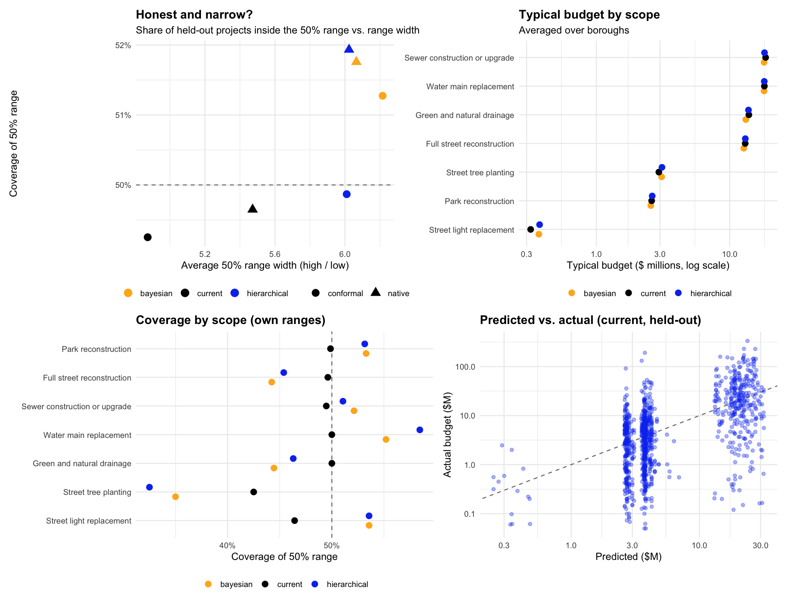

# Cost model comparison (R appendix)

Same cleaned data as the app (1138 projects, 7 scopes). 2 x 10-fold cross-validation with identical folds for every model. Reproduce with `Rscript analysis/compare_cost_models.R`.

| Model | Ranges | Out-of-sample R² | RMSE (log) | Median abs. % error | Within 2x | 50% coverage | 80% coverage | 50% width | 80% width |
|---|---|---|---|---|---|---|---|---|---|
| bayesian | conformal | 0.287 | 1.344 | 65% | 40% | 51.3% | 79.9% | 6.2x | 36.9x |
| bayesian | native | 0.293 | 1.339 | 64% | 40% | 51.8% | 81.3% | 6.1x | 30.8x |
| current | conformal | 0.294 | 1.338 | 64% | 46% | 49.3% | 80.9% | 4.9x | 43.5x |
| current | native | 0.294 | 1.337 | 64% | 46% | 49.6% | 79.3% | 5.5x | 26.9x |
| hierarchical | conformal | 0.290 | 1.341 | 65% | 39% | 49.9% | 80.6% | 6.0x | 40.7x |
| hierarchical | native | 0.294 | 1.337 | 65% | 39% | 51.9% | 81.2% | 6.0x | 30.3x |

**Accuracy vs. the current model** (paired tests on squared errors of the same held-out projects):

- hierarchical: change in mean squared error -0.0003 (paired t p = 0.918; Wilcoxon p = 0.895)
- bayesian: change in mean squared error +0.0030 (paired t p = 0.386; Wilcoxon p = 0.498)

**Variance components** (log scale, standard deviations):

- Hierarchical: scope 1.462; borough 0.161; Residual 1.331
- Bayesian (posterior): scope 1.683; borough 0.282; Residual 1.332

**Winner rule:** more accurate (p < 0.05), 50% and 80% coverage within 3 points of target, and a 50% range no wider than the current model's.

| Model | Ranges | More accurate | Honest ranges | No wider | Wins |
|---|---|---|---|---|---|
| bayesian | conformal | FALSE | TRUE | FALSE | FALSE |
| bayesian | native | FALSE | TRUE | FALSE | FALSE |
| current | conformal | FALSE | TRUE | TRUE | FALSE |
| hierarchical | conformal | FALSE | TRUE | FALSE | FALSE |
| hierarchical | native | FALSE | TRUE | FALSE | FALSE |

**Decision:** No new model met all three conditions; the app keeps the current model.

